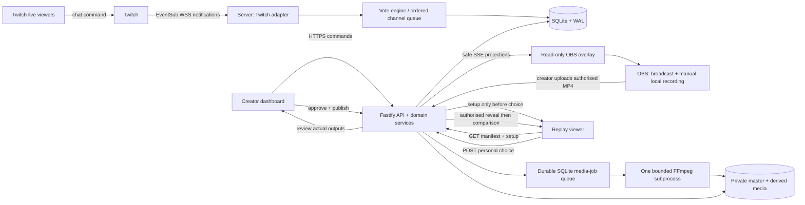

# Playable Moments — final MVP architecture
**Baseline 1.0 | 26 October 2026 | Implementation specification, not an implemented product**

This label describes the original design document. The application has since been implemented; [README.md](README.md) and [docs/PROGRESS.md](docs/PROGRESS.md) record the runnable product and actual verification results. Requirements below are not, by themselves, evidence that a check passed.

## 1. Product contract
A creator asks an A/B question during a Twitch stream. Genuine chat responses are accepted while that moment is open. The app locks a historical snapshot, records the creator's actual choice and the observed outcome, and attaches a creator-authorised recording. The creator checks the video boundaries and the processed outputs before publication. A replay viewer watches the setup, makes a personal choice, then accesses the actual outcome and compares their choice with the creator and original participating audience.

**Hinglish:** Live mein jo sawaal aur choice hui thi, wahi baad ke viewer ko answer dikhane se pehle milegi. Uski choice original video ya live votes ko change nahi karegi.

The contribution is the connected live-to-replay workflow, not invention of polling, quizzes, video editing, or alternate endings. Demand and prize outcomes are not established.

## 2. Scope decisions — fixed for MVP
| Decision | Default |
|---|---|
| Creator support | One allowlisted Twitch broadcaster per installation. |
| Choices | Exactly A and B; first accepted account vote wins. |
| Simultaneous voting | One OPEN moment per channel. |
| Chat command | `!pick <moment-code> A` or `!pick <moment-code> B`. |
| Vote window | Creator chooses 20–180 seconds; default 45. Server deadline and explicit lock are authoritative. |
| Media source | Manual upload of a short creator-owned/authorised MP4 recording. |
| Timing | Live markers suggest boundaries only. Creator sets and verifies authoritative media offsets. |
| Replay mechanism | Separate encoded SETUP and REVEAL assets; choice-gated reveal. |
| Publishing | Human approval of actual processed outputs; then an immutable version. |
| Replay identity | Anonymous first-party browser session; no viewer login required. Not proof of unique humans. |
| Hosting | Local development, then one HTTPS host with persistent disk. |
| Runtime AI | None. Codex is the development tool, not a production dependency. |
| Presentation | Real integration + creator verification + replay choice in one clear story. |

Out of scope: native Twitch UI changes, Twitch Extensions, automatic moment detection, automatic video understanding, alternate endings, a game engine, public media uploads by viewers, multi-channel SaaS onboarding, paid votes, API-based clip imports, a full OBS-control integration, and automatic answer correctness inference.

## 3. System map

The diagram shows responsibilities, not separate microservices. Fastify, the domain services, Twitch adapter, SSE hub, SQLite access, and media-job scheduler run in one server application. FFmpeg runs in a bounded child process so encoding does not block the JavaScript event loop. It still consumes CPU; limit concurrency and threads.

## 4. Technology choices
| Layer | Choice | Reason for this project |
|---|---|---|
| Runtime | Node.js 24 LTS | A currently supported baseline [S12]. |
| UI | React, TypeScript strict, Vite, React Router, plain CSS/CSS modules | One language and small client surfaces. Use accessible native controls. |
| Server | Fastify, Zod validation, structured logs | Small typed HTTP API; enforce schemas server-side. |
| DB | SQLite, `better-sqlite3`, explicit SQL migrations | Single-host persistence without another service. Keep transactions short. |
| Live browser updates | Server-Sent Events; HTTP POST for commands | One-way state updates are enough. Do not add Socket.IO without a need. |
| Twitch | Server-side EventSub WebSocket + OAuth user access token | Read the authorised broadcaster's chat [S04–S09]. |
| Video | FFprobe + FFmpeg child processes | Inspect media and encode reviewed setup/reveal segments [S11]. |
| Tests | Vitest, Playwright; deterministic fixtures | Domain, API/access, browser playback and adversarial scenarios. |
| Deployment | One Docker application, persistent `/data`, HTTPS reverse proxy | Reproducible, modest operational scope. Not a multi-replica design. |

Pin the exact tested package versions in the lockfile when Codex scaffolds. Do not assume this blueprint validates future dependency compatibility. Use system FFmpeg builds with needed codecs; document the build and third-party licensing. No claim of sponsor-provided hosting or API credits.

## 5. Server modules
- **Auth:** allowlisted creator identity, OAuth state, user-token refresh/validation, owner sessions, anonymous replay sessions, CSRF.
- **TwitchAdapter:** one channel subscription, envelope validation, duplicate handling, reconnect/revocation, source-channel filtering, health signals.
- **MomentService:** draft/open/lock/outcome lifecycle, one-open invariant, codes, immutable text after opening.
- **VoteService:** parse explicit commands, serialise channel mutations, first-vote policy, immutable tally snapshot.
- **MediaService:** controlled upload, inspection, private normalised master, edit revisions, bounded render jobs and private review assets.
- **PublicationService:** verify all approval requirements, create immutable release, safe slug, revocation/unpublish.
- **ReplayService:** safe public manifest, session-bound first choice, authorised reveal access, separate result endpoint.
- **Projection/SSE:** owner view versus overlay/public views. Never serialise a complete database object into a public response.
- **Audit/Health:** record state transitions and errors without secrets or unrelated chat content.

## 6. Browser surfaces and roles
| Route | Audience | Must contain | Must not expose |
|---|---|---|---|
| `/` | Public | Product explanation, creator sign-in | Owner credentials or draft media. |
| `/studio` | Owner | Twitch health, sessions/moments, create action | Publicly reachable admin bypass. |
| `/studio/moments/:id/live` | Owner | A/B question, deadline, lock, actual choice and outcome | Owner controls in OBS output. |
| `/studio/moments/:id/review` | Owner | Upload/master preview, four boundaries, rendered output preview, approve/publish | Automatic approval after edits. |
| `/overlay/:key` | Read capability | Question, A/B labels, moment code, window status, neutral participation count | A/B split, creator choice, outcome, source media, settings. |
| `/m/:slug` | Replay participant | Setup, decision card, then authorised reveal and comparison | Spoiler fields before choice. |
| `/privacy` | Public | Data handling and deletion contact/procedure | Claims of absolute anonymity. |

## 7. End-to-end lifecycle
1. Owner authenticates and the app confirms the expected Twitch user ID and read permission.
2. Owner creates a stream session and a DRAFT moment with safe title, question, and A/B labels.
3. Owner starts OBS recording manually and notes a visible neutral sync cue. This cue is for review, not an assertion of perfect clock alignment.
4. Owner opens the moment. The question freezes, a code appears, and a deadline is stored.
5. The adapter receives actual Twitch notifications. Only valid moment-coded choices are considered. A valid first vote becomes a persisted vote, not an in-memory-only counter.
6. The owner or deadline locks the moment in the same ordered mutation stream as votes. A snapshot is calculated in the lock transaction.
7. The owner selects the option they actually chose and records what really happened. Do not infer creator choice from the crowd majority.
8. Owner stops/remuxes their local recording and uploads it. It is private, probed, bounded, and normalised for review.
9. Owner confirms setup/reveal boundaries in the normalised master. Live markers are suggestions; media offsets are the source of truth.
10. A job encodes two separate output files. The owner previews BOTH outputs with audio, confirms the split, ownership/permission, and safe poster/title.
11. Publication creates an immutable release referencing the locked tally and approved media revision.
12. A replay participant receives only a safe manifest and setup file. At setup end, the UI asks A/B.
13. A committed personal choice creates an anonymous-session attempt and grants access to that release's reveal file.
14. After reveal playback, the UI requests the comparison: their choice, creator choice, actual outcome, and the frozen live A/B counts. Historical percentages always name their denominator.

## 8. The key video design decision
Do not implement the primary replay as one long public file with a JavaScript timer that tries to pause at the right frame. Instead, publish a reviewed setup file and keep the reveal behind the choice route. Setup playback physically contains no later video bytes. The underlying uploaded master stays owner-only.

This prevents accidental crossing of the chosen video boundary during ordinary playback. It does **not** detect spoilers already spoken or visible inside the setup, prevent deliberate developer-tools inspection after a choice, stop someone opening another session, or offer DRM. Creator review remains mandatory.

## 9. Deployment map
**Development:** the browser uses `http://localhost:5173` (APP_ORIGIN); the React dev server proxies `/api` and `/auth` to Fastify on `http://localhost:3000`. The registered OAuth callback is the backend URL on port 3000; after it sets a localhost cookie, redirect to the exact allowed frontend origin. Origin/CSRF checks allow the configured frontend origin only. Bind demo admin to loopback. SQLite and media live in a gitignored directory. Twitch connections are outbound; no public EventSub callback is needed for WebSocket transport [S05]. Local OAuth redirect still must match the registered URL.

**Hosted demonstration:** React's built files are served by Fastify behind HTTPS on one domain. The app continues using the allowlisted broadcaster's user token and one outbound WSS subscription; this is not a general multi-broadcaster bot service. OBS on the creator's machine loads the hosted read-only overlay. The creator uploads their local recording over HTTPS. Replay viewers use the same domain.

One persistent application volume stores the DB and media. Do not deploy to ephemeral serverless functions or multiple replicas with shared SQLite. Media bandwidth is a separate constraint from ingesting 1,000 votes. A future CDN/object store is an extension, not a prerequisite to the MVP.

## 10. Architectural decisions and trade-offs
- **Single deployment:** reduces integration work. Future scale can replace storage/adapters; do not pre-build distributed infrastructure.
- **SSE not bidirectional browser sockets:** mutations remain explicit authorised requests; reconnect uses a fresh safe snapshot.
- **First vote wins:** simple, reproducible counting without update-order ambiguity. It is one account, not one human.
- **Moment code is mandatory:** prevents old delayed commands from being applied to the next question.
- **Fail-closed interruption:** a disconnected voting round is not presented as a complete sample.
- **Text/data captured once; media reviewed:** reduces duplicate data entry without claiming automatic temporal alignment.
- **Split media:** predictable choice boundary at the cost of an encoding step and a second playback start.
- **Anonymous replay:** low friction, but no reliable distinct-human analytics or prize-grade vote integrity.
- **No automatic Twitch video import:** avoids relying on VOD availability and embed controls for the first deliverable.
- **No runtime AI:** correctness and operating cost do not depend on model calls.

## 11. What is supplied versus still to build
Supplied: design documents, reference DDL, machine-readable contracts, simulated examples, diagrams, and contract-check scripts. Codex must build and verify the running UI/server/media pipeline, actual Twitch authorisation, deployments, and all application tests. Nothing in this document is evidence that the user's Twitch account or local OBS setup has already been tested.

See `docs/09_SOURCES_AND_ASSUMPTIONS.md` for verified external constraints versus our own design choices.
