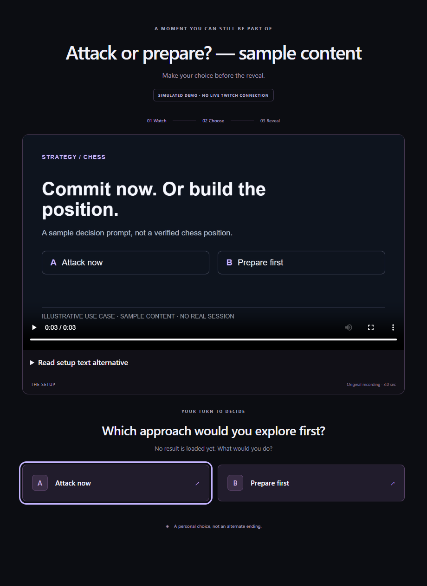
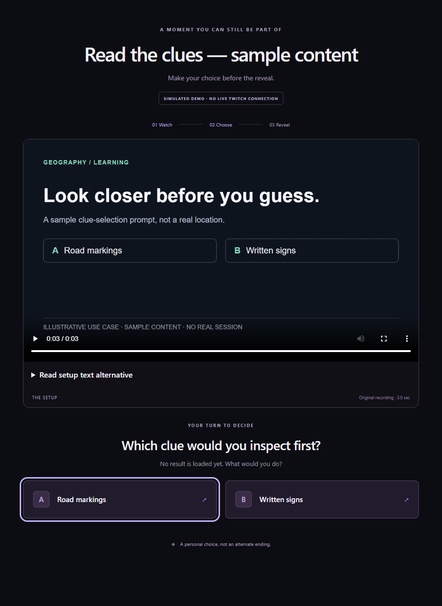
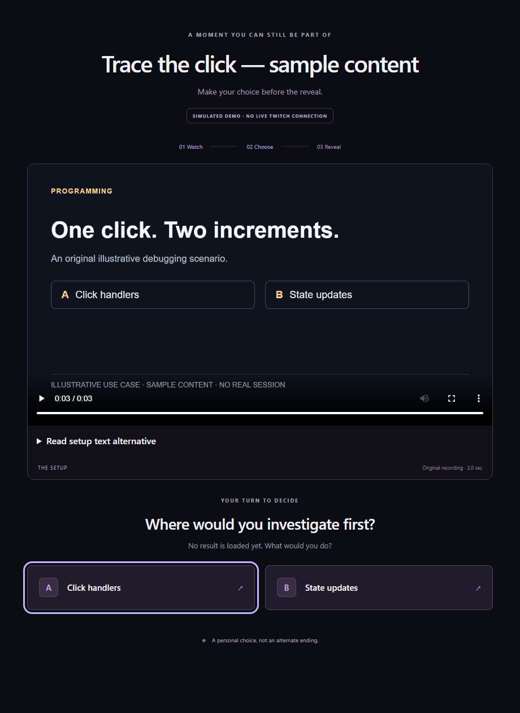

# Proposed slide: Illustrative use cases

**Local proposal only — the saved Spaces presentation has not been edited.** Use after the single complete running-product example, for about 15 seconds. It illustrates possible content formats, not adoption, endorsed creators or three completed learning products.

## Slide copy and layout

Title: **Same workflow. Different content.**

Subtitle: **Gaming challenges · Chess and strategy · Programming · Educational demonstrations**

Evidence label above the screenshots: **Illustrative use cases**. Keep the existing three sample screenshots; they illustrate topics, not completed recordings. The original game supplies the preserved gaming example. Do not relabel the strategy question-card screenshot as an independent chess reconstruction: no board/game sequence exists in that image.

Three equal columns, each with its original sample screenshot, a topic label and one sentence:

| Strategy / chess | Geography / learning | Programming |
|---|---|---|
| Predict an approach. Then explain the tactical cue. | Inspect a clue. Then explain what it tells you. | Predict a cause. Then trace what the code did. |
| [Strategy screenshot](fun-learning/strategy-sample.png) | [Geography screenshot](fun-learning/geography-sample.png) | [Programming screenshot](fun-learning/programming-sample.png) |

Persistent footer: **Illustrative use cases · original sample content · no real session, votes or endorsement**

Speaker line for the completed demo: “The same workflow can use a creator's own or authorised recording: a game challenge, a chess decision, a coding session or an educational demonstration. These supporting images are illustrative use cases.” The primary chess clip has its own independent-reconstruction disclosure; do not imply a celebrity used or endorsed the app.

Use the three columns as a visual summary. Keep the large topic/caption text legible; do not expect viewers to read every control in the small screenshots. If enlarging a screenshot, retain its **sample content** title and **SIMULATED DEMO** badge. Do not add counts, a correct answer, logos, source creator portraits or social proof.

For the existing eight-slide deck, this could replace part of slide 7's broader-use discussion while retaining the current product limits. A final slide edit and final demo-video insertion are later work, after the main media choice. A slide does not replace required functioning-product footage.

## Screenshot provenance

These are screenshots of the existing built Playable Moments replay UI, supplied with browser-only DEMO manifests in fresh isolated browser contexts. The three setup clips are original silent typographic cards created solely for these screenshots. No chess position, real location, source creator action or outcome is depicted. Programming's “one click, two increments” is explicitly an invented illustrative scenario, not a claim about a particular stream.

No running application API, database, Twitch account or publication operation was used. All browser requests were fulfilled locally or rejected. There were no owner/API writes, result/reveal requests or external requests. No A/B choice was submitted. The setup clips finished naturally to expose the existing choice controls.

The **Original recording · 3.0 sec** line is the existing player label for each original sample card clip; three seconds is fixture duration only, not a proposed source-video cut point. These illustrations are not an end-to-end test or evidence of new live activity.

Machine-readable checks and image hashes: [sample receipt](fun-learning/sample-receipt.json). Only these PNG screenshots and the sanitised receipt are presentation assets. The one-off renderer/cards/MP4 files remain under ignored `data/qa-2026-10-31/`; they are not production media, new application code or a second presentation system.

## Full-size reference images

### Strategy / chess

### Geography / learning

### Programming

